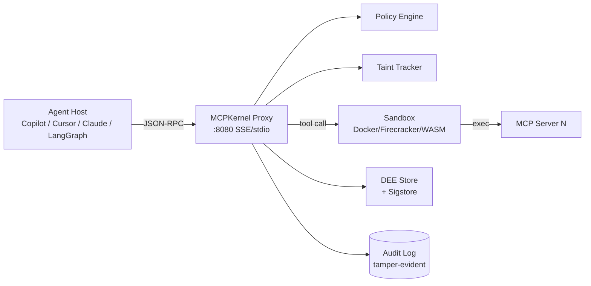

# MCPKernel Threat Model

**Document version:** 1.0 (v0.3.0)  
**Methodology:** [STRIDE](https://learn.microsoft.com/azure/security/develop/threat-modeling-tool)  
**Scope:** the MCPKernel proxy, policy engine, sandbox backends, DEE
store, audit log, and the agent.yaml manifest loader. Out of scope: the
upstream LLM provider, the host application, the MCP server
implementations behind the proxy.

---

## 1. System overview

## 2. Trust boundaries

| # | Boundary | Crossed by |
|---|----------|-----------|
| TB-1 | Host ↔ Proxy | OAuth2 bearer, resource indicator (RFC 8707) |
| TB-2 | Proxy ↔ Policy/Taint (in-process) | Python function calls — no boundary, but isolated module |
| TB-3 | Proxy ↔ Sandbox | gVisor/Firecracker syscall boundary, eBPF filter |
| TB-4 | Sandbox ↔ MCP server | stdio or socket inside sandbox |
| TB-5 | Proxy ↔ DEE/Audit on disk | filesystem permissions, Sigstore signatures |
| TB-6 | Operator ↔ Helm/Kubernetes | RBAC, secret refs |

## 3. Data flows (numbered)

1. Host → Proxy: `initialize`, `tools/call`, `elicitation/create`.
2. Proxy → Policy: rule evaluation with taint context.
3. Proxy → Sandbox: serialized tool args.
4. Sandbox → MCP server: stdio JSON-RPC.
5. MCP server → Sandbox → Proxy: result (content + structuredContent).
6. Proxy → DEE store: hashed envelope, signed.
7. Proxy → Audit log: append-only entry.
8. Operator → CLI: `mcpkernel validate-policy`, `mcpkernel trace-replay`.

## 4. STRIDE assessment

### 4.1 Spoofing

| ID | Threat | Asset | Mitigation | Residual |
|----|--------|-------|------------|----------|
| S-1 | Forged host identity | TB-1 | OAuth2, RFC 8707 resource indicators (default since v0.2 advances); reject unscoped tokens | Low — token theft only |
| S-2 | Forged MCP server identity | TB-4 | Sandbox isolates server; server identity captured in DEE envelope hash | Low |
| S-3 | Fake DEE / replay record | TB-5 | Sigstore Bundle v0.3 with cert binding; `MCPKERNEL_DEE__REQUIRE_SIGN` fail-closed | Very low |
| S-4 | Forged audit entry | TB-5 | DSSE in-toto v1 batch attestations, append-only file, hash chain | Very low |

### 4.2 Tampering

| ID | Threat | Asset | Mitigation | Residual |
|----|--------|-------|------------|----------|
| T-1 | Modify tool args mid-flight | flows 1–3 | Single-process proxy, no IPC for hot path; TLS at TB-1 | Low |
| T-2 | Edit policy file at rest | policies/*.yaml | `policy-lint --strict` in CI; signed config recommended via Helm `existingSecret` | Medium — operator must protect file |
| T-3 | Modify uv.lock or wheels | supply chain | CycloneDX SBOM, Sigstore wheels, CodeQL | Low |
| T-4 | Modify audit log | TB-5 | Append-only, periodic DSSE attestation, off-host shipping recommended | Medium without remote SIEM |
| T-5 | Corrupt DEE envelope | DEE store | Hash + signature verified on read | Very low |

### 4.3 Repudiation

| ID | Threat | Asset | Mitigation | Residual |
|----|--------|-------|------------|----------|
| R-1 | Agent denies issuing a tool call | flows 1, 7 | Every call audited with bearer subject + correlation id; DEE replayable | Very low |
| R-2 | Operator denies policy change | policies/ | Recommend Git-tracked policies + signed commits | Operational |
| R-3 | Tool denies producing output | flow 5 | DEE captures stdin/stdout/exit; Sigstore-signed | Very low |

### 4.4 Information disclosure

| ID | Threat | Asset | Mitigation | Residual |
|----|--------|-------|------------|----------|
| I-1 | Secret leaks via tool args | flow 1 | Taint detectors on `SECRET`/`PII`; `deny_on_taint` rules | Low |
| I-2 | Secret leaks via tool result | flow 5 | Post-execution taint scan (v0.2 advances); structuredContent rewriter | Low |
| I-3 | System prompt leak | flow 5 | `SYSTEM_PROMPT` taint label; OWASP-ASI strict preset blocks | Low |
| I-4 | Side-channel via metrics | observability | Metrics are aggregated counts; no payloads exposed | Very low |
| I-5 | Audit log read by attacker | TB-5 | File mode 0600, K8s `automountServiceAccountToken: false`, ship to SIEM | Operational |

### 4.5 Denial of service

| ID | Threat | Asset | Mitigation | Residual |
|----|--------|-------|------------|----------|
| D-1 | Flood proxy with tool calls | flow 1 | Per-agent/tool rate-limit token buckets | Low |
| D-2 | Memory exhaustion in sandbox | TB-3 | Cgroup CPU/RAM caps per backend; Firecracker by default | Low |
| D-3 | Pathological regex in policy | T-2 | `policy-lint` PL003/PL004 reject invalid + ReDoS-prone patterns | Low |
| D-4 | Parser crash on malformed JSON-RPC | flow 1 | Hypothesis fuzz tests (Section E) prove parser never raises; structured error response | Low |
| D-5 | Audit log fills disk | TB-5 | Rotation + remote shipping; Prometheus `mcpkernel_audit_entries_total` for capacity alerts | Operational |

### 4.6 Elevation of privilege

| ID | Threat | Asset | Mitigation | Residual |
|----|--------|-------|------------|----------|
| E-1 | Tool escapes sandbox | TB-3 | gVisor/Firecracker, eBPF syscall filter, drop ALL caps, non-root, read-only rootfs | Low |
| E-2 | Agent invokes tool outside manifest | flow 1 | `agent.yaml` `tool_validator` enforces allow-list at proxy hook | Low |
| E-3 | Prompt-injection → privileged tool | flow 5 → 1 | Taint propagation + `block_on_taint: [USER_INPUT]` on shell/network tools | Low |
| E-4 | RCE via dependency | supply chain | CodeQL `security-and-quality`, `pip-audit`, weekly schedule | Low |
| E-5 | Privilege escalation via Helm chart | TB-6 | NetworkPolicy default-deny, ServiceAccount minimal, no automount | Low |

## 5. Top-5 risks (prioritised)

1. **T-4 / I-5 — audit log compromise.** Operators MUST ship audit logs
   off-host. The on-disk log is append-only and DSSE-attested but a
   root attacker with persistent access can still destroy local copies.
2. **T-2 — policy file tampering.** Track `policies/` in Git, lint in
   CI, deploy via signed Helm secret. Plan for v0.4: signature on the
   policy bundle itself.
3. **E-3 — indirect prompt injection.** Mitigated by default for
   `USER_INPUT` taint label but operators must enable
   `block_on_taint: [TOOL_RESULT]` for high-impact tools.
4. **D-2 — sandbox memory exhaustion.** Tune cgroup caps per workload;
   default values target a 256 MiB / 1 vCPU envelope.
5. **S-1 — token theft.** Use short-lived OAuth2 tokens with audience
   binding (`require_resource=True`, default).

## 6. Assumptions

- The host operating system kernel and container runtime are not
  compromised.
- The Sigstore Fulcio + Rekor instance is trusted.
- Operators rotate OAuth2 signing keys.
- TLS terminates either at the proxy or at an Ingress in front of it.

## 7. Out of scope

- Model-layer threats (hallucination, jailbreaks of the LLM itself).
- Physical attacks on operator workstations.
- Compromise of the agent host's secret store (Copilot/Cursor/Claude
  Desktop secrets).
- Side channels in the underlying hardware (Spectre-class).

## 8. Update cadence

This document is reviewed each minor release and whenever a new trust
boundary is added. Significant changes are summarised in `CHANGELOG.md`.
